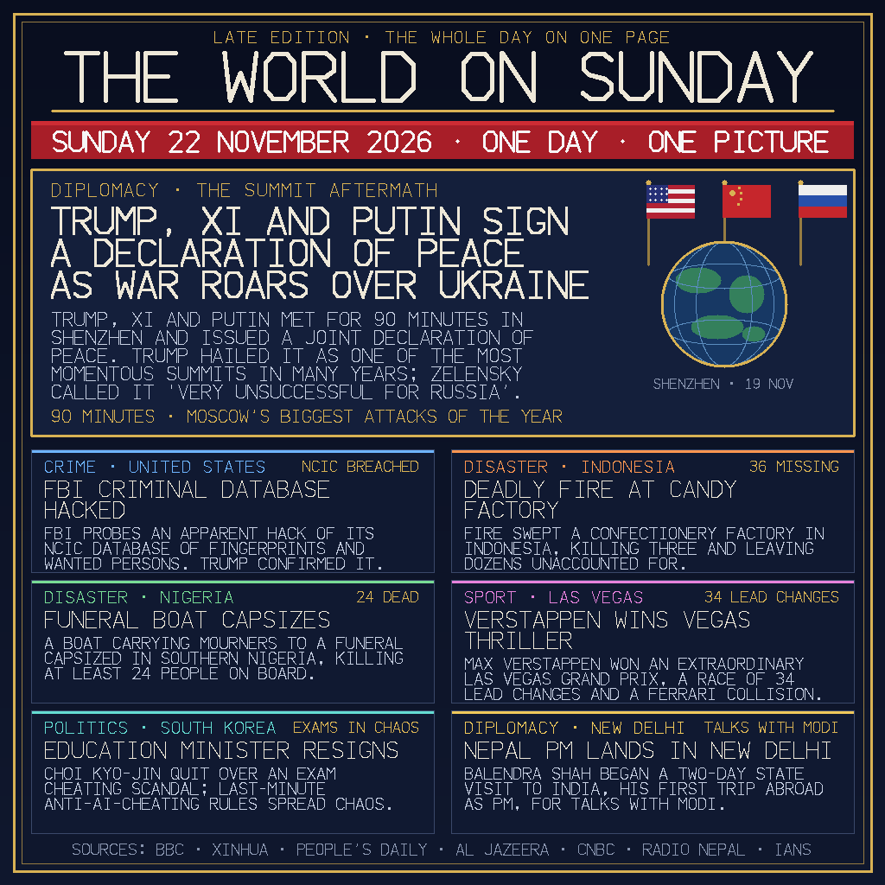

# The World on Sunday — 22 November 2026 in one image

[](https://make.fun/bounty/news-image-20261122)
[](https://make.fun/bounty/news-image-20261122)
[](https://make.fun/bounty/news-image-20261122)

An entry for the make.fun bounty
["Sum up 22 November's world news in one image"](https://make.fun/bounty/news-image-20261122).

`frontpage.py` is a small program that draws a one-page newspaper
poster — **THE WORLD ON SUNDAY**, a deep-navy "late edition" with a
gold-framed masthead, a red date band, one large lead story and six
smaller story boxes — and writes it as `entry.png`.



The day's stories, each cross-checked against at least two sources
(see [facts-20261122.md](facts-20261122.md)):

- **Lead:** the aftermath of the Trump–Xi–Putin summit in Shenzhen —
  a joint declaration of peace, hailed by Trump, dismissed by
  Zelensky as Russia launched its biggest attacks of the year.
- The FBI's NCIC criminal database hacked; Trump confirms the breach.
- A confectionery factory fire in Indonesia: 3 dead, 36 missing.
- A funeral boat capsizes in southern Nigeria: at least 24 dead.
- Verstappen wins a Las Vegas Grand Prix with 34 lead changes.
- South Korea's education minister resigns over the exam-cheating
  scandal.
- Nepal's PM Balendra Shah begins a two-day state visit to India.

## How to run

```sh
python3 frontpage.py
```

That writes `entry.png` (1024 × 1024) next to the script. The program
uses only the Python standard library — its own raster canvas, its own
stroke font drawn from code, and its own PNG encoder — so it needs no
Pillow, no system fonts and no network, and it writes exactly the same
bytes on every run.

## License

MIT — see [LICENSE](LICENSE).
